# Thiết Kế Sơ Đồ UML Chi Tiết — Trading Backtest Engine

> **Dự án:** Trading Backtest Engine (Nền tảng kiểm thử chiến lược giao dịch & Mạng xã hội đầu tư)  
> **Kiến trúc:** Microservices (API Gateway, Auth Service, Realtime Service, Backtest Service, Community Service)  
> **Mục đích:** Tài liệu thiết kế kỹ thuật phần mềm chi tiết, phục vụ Báo cáo Khóa luận Tốt nghiệp & Hiện thực hóa mã nguồn  
> **Chuẩn ký hiệu:** UML 2.5 (Unified Modeling Language) qua cú pháp Mermaid

---

## MỤC LỤC

1. [Tổng Quan Kiến Trúc & Danh Mục Sơ Đồ UML](#1-tổng-quan-kiến-trúc--danh-mục-sơ-đồ-uml)
2. [Sơ Đồ Use Case (Use Case Diagrams)](#2-sơ-đồ-use-case-use-case-diagrams)
   - 2.1 Sơ đồ Use Case tổng thể toàn hệ thống
   - 2.2 Sơ đồ Use Case phân hệ Xác thực & Quản lý Tài khoản (Auth Service)
   - 2.3 Sơ đồ Use Case phân hệ Dữ liệu Thị trường Thời gian thực (Realtime Service)
   - 2.4 Sơ đồ Use Case phân hệ Động cơ Kiểm thử Chiến lược (Backtest Engine Service)
   - 2.5 Sơ đồ Use Case phân hệ Mạng Xã Hội Giao Dịch & Cộng Đồng (Community Service)
3. [Sơ Đồ Lớp (Class Diagrams)](#3-sơ-đồ-lớp-class-diagrams)
   - 3.1 Sơ đồ Lớp phân hệ Backtest Engine (Domain Entities, Models & Engine Services)
   - 3.2 Sơ đồ Lớp phân hệ Mạng Xã Hội Đầu Tư (Community Entities & Domain Model)
   - 3.3 Sơ đồ Lớp phân hệ Xác thực & Dữ liệu Thị trường (Auth & Realtime Service)
4. [Sơ Đồ Tuần Tự (Sequence Diagrams)](#4-sơ-đồ-tuần-tự-sequence-diagrams)
   - 4.1 Luồng Xác thực Đăng nhập & Điều hướng JWT qua API Gateway
   - 4.2 Luồng Đăng ký Nhận Stream Nến Thời Gian Thực qua WebSocket STOMP
   - 4.3 Luồng Thực thi Kiểm thử Chiến lược Toàn diện (Full Simulation Pipeline)
   - 4.4 Luồng Đăng Ý tưởng Giao dịch & Phát Sinh Thông báo Tương tác
5. [Sơ Đồ Hoạt Động (Activity Diagrams)](#5-sơ-đồ-hoạt-động-activity-diagrams)
   - 5.1 Lưu đồ Thuật toán Động cơ Kiểm thử Chiến lược Từng Nến (Candle-by-Candle Simulation)
   - 5.2 Quy trình Gia nhập & Phê duyệt Thành viên Nhóm Cộng đồng
6. [Sơ Đồ Trạng Thái (State Machine Diagrams)](#6-sơ-đồ-trạng-thái-state-machine-diagrams)
   - 6.1 Vòng đời Phiên chạy Backtest (`BacktestRun`)
   - 6.2 Vòng đời Vị thế Lệnh Giao dịch (`TradeRecord`)
   - 6.3 Vòng đời Quan hệ Bạn bè & Trạng thái Thành viên Nhóm
7. [Sơ Đồ Thành Phần & Triển Khai (Component & Deployment Diagrams)](#7-sơ-đồ-thành-phần--triển-khai-component--deployment-diagrams)
   - 7.1 Sơ đồ Thành phần (Component Diagram)
   - 7.2 Sơ đồ Triển khai Vật lý (Deployment Diagram)

---

## 1. TỔNG QUAN KIẾN TRÚC & DANH MỤC SƠ ĐỒ UML

Hệ thống **Trading Backtest Engine** được thiết kế theo kiến trúc Microservices phân tán với các thành phần cốt lõi:
- **Client Tier**: Ứng dụng Single-Page Application (React, Vite, TypeScript, TailwindCSS, TradingView Lightweight Charts).
- **Gateway Tier**: API Gateway (Spring Cloud Gateway, Port 8080) làm điểm đón duy nhất, chịu trách nhiệm Reverse Proxy, CORS, Load Balancing, bảo mật.
- **Service Tier**:
  1. `auth-service` (Port 8081): Quản lý người dùng, mã hóa mật khẩu BCrypt, cấp phát và xác thực JWT token.
  2. `realtime-service` (Port 8082): Tích hợp Binance REST/WebSocket API, stream nến Candlestick thời gian thực tới frontend qua WebSocket STOMP (`/ws/market`).
  3. `backtest-service` (Port 8083): Động cơ tính toán tài chính cốt lõi (Core Engine) dựa trên thư viện phân tích kỹ thuật `ta4j`, mô phỏng trượt giá (slippage), phí giao dịch (commission), phân bổ vốn (portfolio) và 22 chỉ số thống kê tài chính chuẩn mực (Sharpe, Sortino, Calmar, Max Drawdown,...).
  4. `community-service` (Port 8084): Mạng xã hội đầu tư tài chính với Ý tưởng giao dịch (Trading Ideas), bài viết (Posts), tương tác cảm xúc, bình luận phân cấp, kết bạn, nhóm và hệ thống thông báo realtime.
- **Persistence Tier**: Cơ sở dữ liệu quan hệ MySQL 8.0 (`backtest_trading_system`) quản lý giao dịch ACID và toàn vẹn dữ liệu.

---

## 2. SƠ ĐỒ USE CASE (USE CASE DIAGRAMS)

### 2.1 Sơ đồ Use Case Tổng Thể Toàn Hệ Thống

Sơ đồ tổng quan toàn bộ hệ thống phân chia theo 4 phân hệ Microservices chính, hiển thị từ trái sang phải với các tác nhân (Actors) và mối quan hệ `<<include>>`, `<<extend>>` giữa các ca sử dụng:

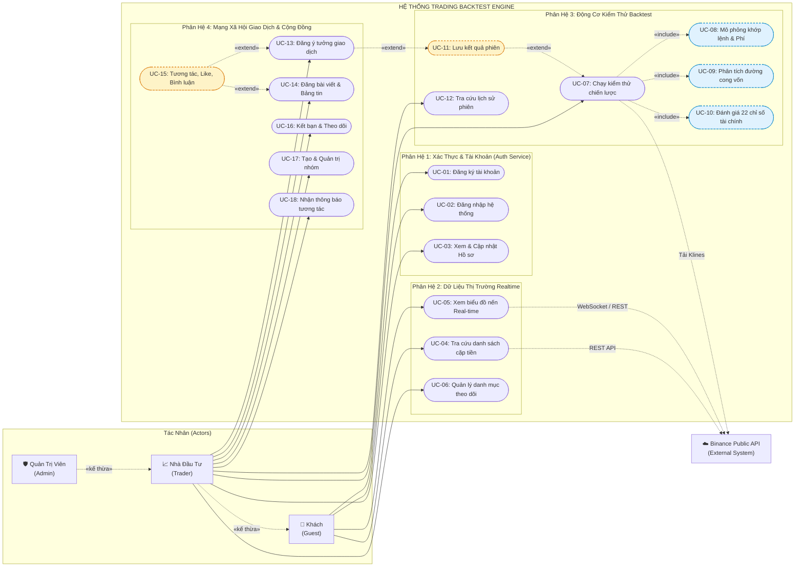

---

### 2.2 Sơ đồ Use Case Phân Hệ Xác Thực & Quản Lý Tài Khoản (Auth Service)

Sơ đồ thể hiện quy trình quản lý danh tính, phân quyền và cấp phát JWT Token theo chiều từ trái sang phải:

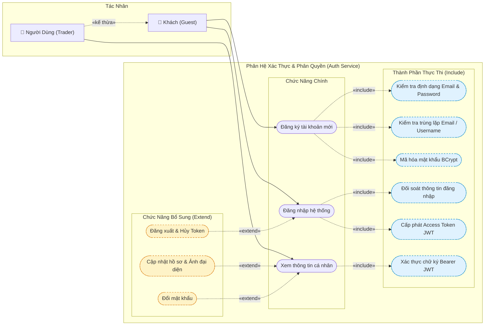

---

### 2.3 Sơ đồ Use Case Phân Hệ Dữ Liệu Thị Trường Realtime (Realtime Service)

Sơ đồ mô tả quy trình tiếp nhận và truyền phát dữ liệu thị trường từ Binance Public API đến Trader theo thời gian thực (Left-to-Right):

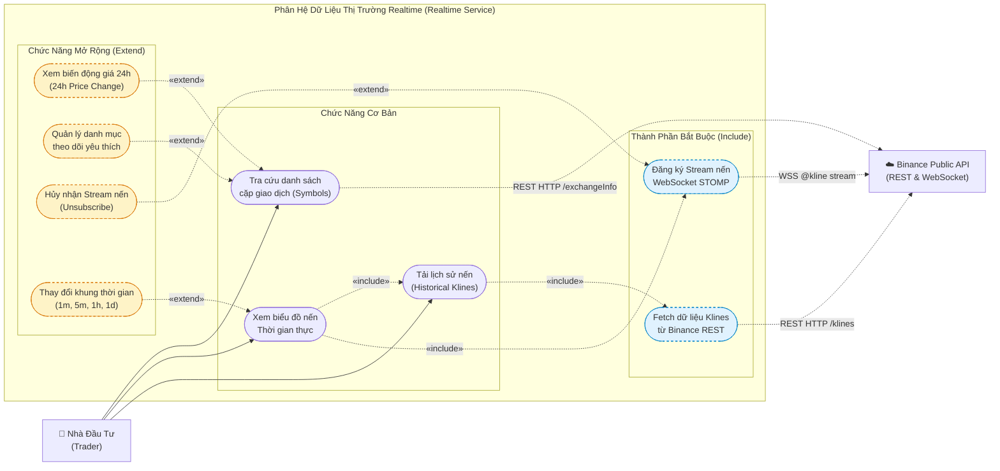

---

### 2.4 Sơ đồ Use Case Phân Hệ Động Cơ Kiểm Thử Chiến Lược (Backtest Engine Service)

Sơ đồ quy trình thực thi kiểm thử chiến lược định lượng từ cấu hình tham số, mô phỏng khớp lệnh đến tính toán 22 chỉ số tài chính (Left-to-Right):

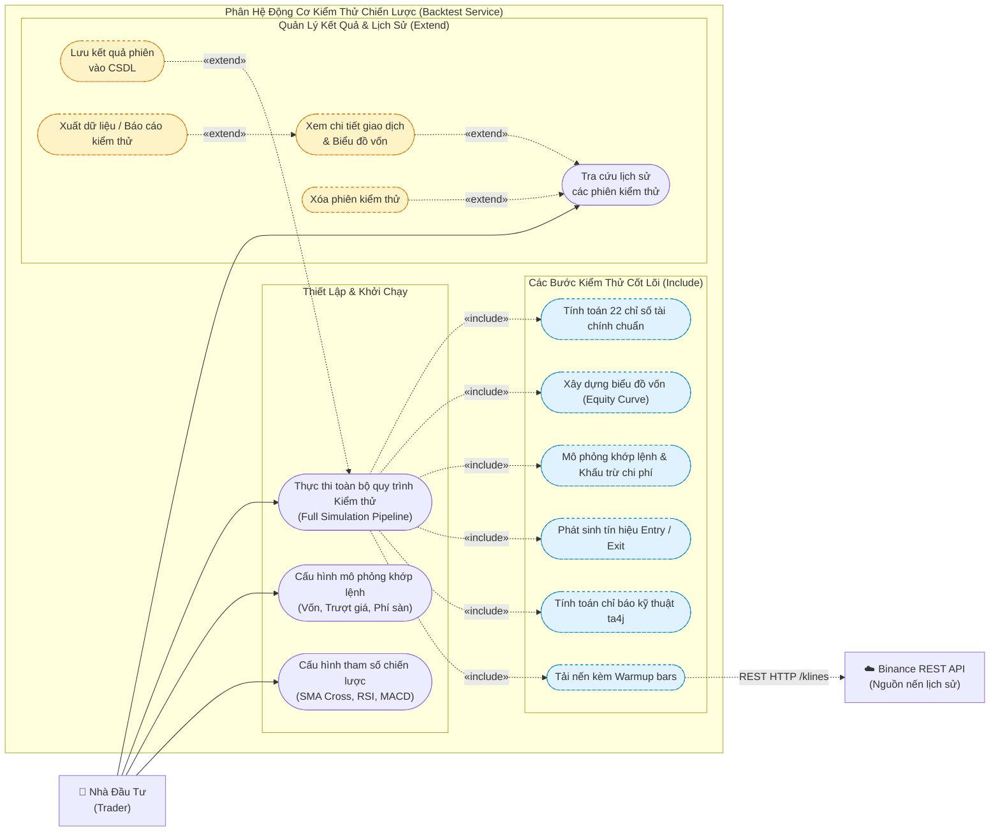

---

### 2.5 Sơ đồ Use Case Phân Hệ Mạng Xã Hội Giao Dịch & Cộng Đồng (Community Service)

Sơ đồ mô tả các ca sử dụng chia sẻ ý tưởng, bài viết, kết nối bạn bè, hội nhóm và thông báo tương tác (Left-to-Right):

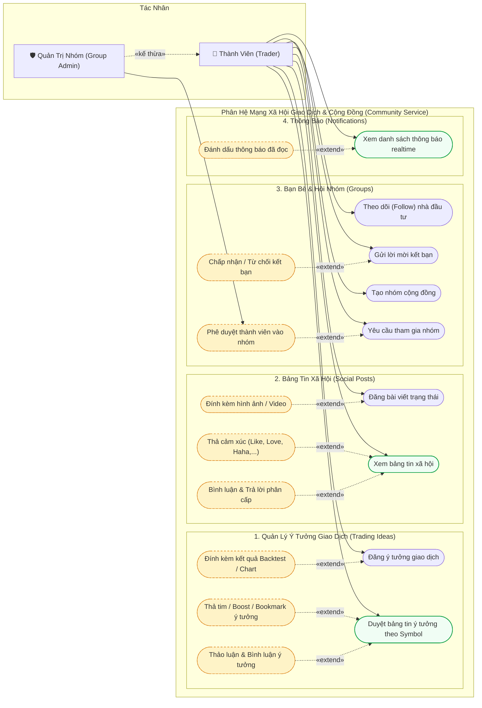

---

## 3. SƠ ĐỒ LỚP (CLASS DIAGRAMS)

### 3.1 Sơ Đồ Lớp Phân Hệ Backtest Engine (Domain Entities, Models & Engine Services)

Sơ đồ lớp chi tiết thể hiện toàn bộ các lớp nghiệp vụ, mô hình dữ liệu quan hệ, quan hệ thừa kế, hiện thực hóa Interface và phụ thuộc trong `backtest-service`:

```mermaid
classDiagram
    %% Core Entities & Domain Models
    class BacktestRun {
        -Long id
        -Long userId
        -StrategyType strategyType
        -String strategyParams
        -String symbol
        -String timeframe
        -Instant startTime
        -Instant endTime
        -BacktestStatus status
        -Long executionDurationMs
        -Instant createdAt
        +getId() Long
        +getStatus() BacktestStatus
        +setStatus(BacktestStatus) void
    }

    class MetricsSnapshot {
        -Long id
        -BacktestRun backtestRun
        -BigDecimal initialCapital
        -BigDecimal finalBalance
        -BigDecimal totalReturnPercent
        -Integer totalTrades
        -Integer winningTrades
        -Integer losingTrades
        -BigDecimal winRate
        -BigDecimal profitFactor
        -BigDecimal averageWin
        -BigDecimal averageLoss
        -BigDecimal bestTrade
        -BigDecimal worstTrade
        -Integer maxConsecutiveWins
        -Integer maxConsecutiveLosses
        -BigDecimal expectancy
        -BigDecimal rewardRiskRatio
        -BigDecimal maxDrawdown
        -BigDecimal recoveryFactor
        -BigDecimal sharpeRatio
        -BigDecimal sortinoRatio
        -BigDecimal calmarRatio
        -BigDecimal cagr
        -Instant createdAt
    }

    class TradeRecord {
        -Long id
        -BacktestRun backtestRun
        -Integer tradeNumber
        -TradeSide side
        -Instant entryTime
        -Instant exitTime
        -BigDecimal entryPrice
        -BigDecimal exitPrice
        -BigDecimal quantity
        -BigDecimal grossProfit
        -BigDecimal commission
        -BigDecimal slippageCost
        -BigDecimal netProfit
        -BigDecimal returnPercent
        -Integer holdingPeriodBars
        -BigDecimal maxFavorableExcursion
        -BigDecimal maxAdverseExcursion
        -BigDecimal cumulativePnl
        -BigDecimal sizeUsd
        -String entrySignal
        -String exitSignal
    }

    class EquityPointEntity {
        -Long id
        -BacktestRun backtestRun
        -Instant timestamp
        -BigDecimal equity
        -BigDecimal cash
        -BigDecimal openPositionPnl
        -Integer tradeNumber
        -Instant createdAt
    }

    class BacktestStatus {
        <<enumeration>>
        PENDING
        RUNNING
        COMPLETED
        FAILED
    }

    class TradeSide {
        <<enumeration>>
        BUY
        SELL
    }

    class StrategyType {
        <<enumeration>>
        SMA_CROSS
        RSI
        MACD
    }

    %% Strategy Pattern & Factories
    class TradingStrategyFactory {
        <<interface>>
        +getStrategyType() StrategyType
        +getRequiredWarmupBars(StrategyParameters) int
        +build(BarSeries, StrategyParameters) Strategy
    }

    class SmaCrossStrategyFactory {
        +getStrategyType() StrategyType
        +getRequiredWarmupBars(StrategyParameters) int
        +build(BarSeries, StrategyParameters) Strategy
    }

    class RsiStrategyFactory {
        +getStrategyType() StrategyType
        +getRequiredWarmupBars(StrategyParameters) int
        +build(BarSeries, StrategyParameters) Strategy
    }

    class MacdStrategyFactory {
        +getStrategyType() StrategyType
        +getRequiredWarmupBars(StrategyParameters) int
        +build(BarSeries, StrategyParameters) Strategy
    }

    class StrategyFactoryRegistry {
        -Map~StrategyType, TradingStrategyFactory~ factoryMap
        +register(TradingStrategyFactory) void
        +getFactory(StrategyType) TradingStrategyFactory
    }

    %% Core Calculation Services
    class BacktestService {
        -MarketDataService marketDataService
        -StrategyFactoryRegistry strategyFactoryRegistry
        -BacktestEngine backtestEngine
        -BacktestTradingRecordMapper tradingRecordMapper
        +execute(BacktestCommand) BacktestResult
    }

    class ExecutionSimulationService {
        -MarketDataService marketDataService
        -StrategyFactoryRegistry strategyFactoryRegistry
        -BacktestEngine backtestEngine
        -ExecutionService executionService
        -PortfolioService portfolioService
        -MetricsService metricsService
        -FullSimulationResponseMapper fullResponseMapper
        +execute(ExecutionSimulationCommand) List~ExecutedTrade~
        +simulate(PortfolioSimulationRequest) PortfolioSimulationResponse
        +fullSimulation(PortfolioSimulationRequest) FullSimulationResponse
    }

    class MarketDataService {
        -BinanceRestClient binanceClient
        -KlineCache klineCache
        +load(MarketDataRequest, int warmupBars) BarSeries
    }

    class BacktestEngine {
        +run(BarSeries, Strategy) TradingRecord
    }

    class ExecutionService {
        +execute(TradingRecord, BarSeries, ExecutionConfig, BigDecimal capital, Instant startTime) List~ExecutedTrade~
    }

    class PortfolioService {
        +calculate(List~ExecutedTrade~, BarSeries, PortfolioConfig, int warmupBars) PortfolioResult
    }

    class MetricsService {
        +calculate(List~ExecutedTrade~, PortfolioResult) MetricsResult
    }

    %% Relationships
    BacktestRun "1" *-- "1" MetricsSnapshot : has
    BacktestRun "1" *-- "0..*" TradeRecord : contains
    BacktestRun "1" *-- "0..*" EquityPointEntity : tracks
    BacktestRun --> BacktestStatus : has state
    BacktestRun --> StrategyType : configured with
    TradeRecord --> TradeSide : direction

    TradingStrategyFactory <|.. SmaCrossStrategyFactory : implements
    TradingStrategyFactory <|.. RsiStrategyFactory : implements
    TradingStrategyFactory <|.. MacdStrategyFactory : implements

    StrategyFactoryRegistry o-- TradingStrategyFactory : registers

    ExecutionSimulationService --> MarketDataService : calls
    ExecutionSimulationService --> StrategyFactoryRegistry : looks up factory
    ExecutionSimulationService --> BacktestEngine : runs ta4j
    ExecutionSimulationService --> ExecutionService : simulates fills
    ExecutionSimulationService --> PortfolioService : evaluates equity
    ExecutionSimulationService --> MetricsService : calculates metrics
    BacktestService --> ExecutionSimulationService : delegates
```

---

### 3.2 Sơ Đồ Lớp Phân Hệ Mạng Xã Hội Đầu Tư (Community Entities & Domain Model)

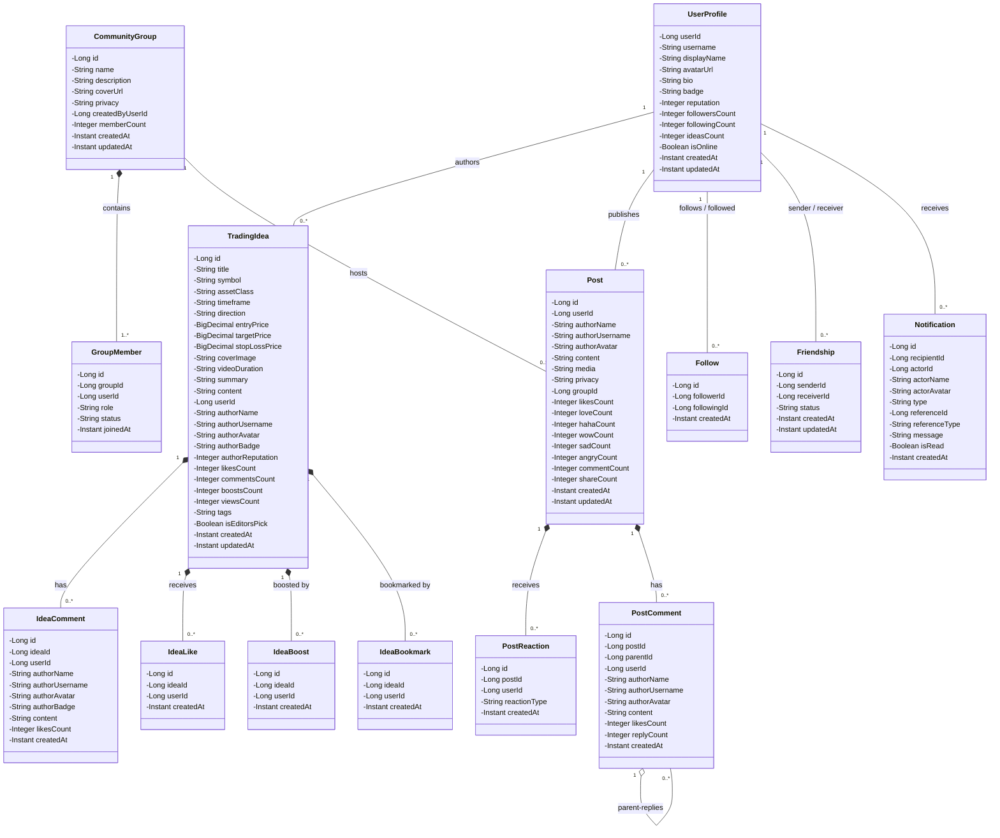

---

### 3.3 Sơ Đồ Lớp Phân Hệ Xác Thực & Dữ Liệu Thị Trường (Auth & Realtime Service)

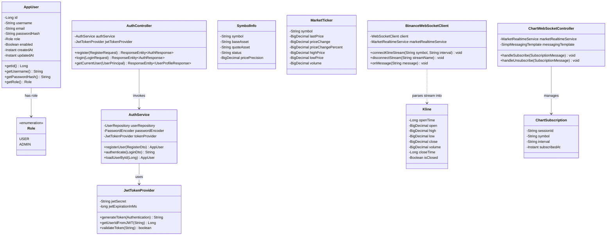

---

## 4. SƠ ĐỒ TUẦN TỰ (SEQUENCE DIAGRAMS)

### 4.1 Luồng Xác Thực Đăng Nhập & Điều Hướng JWT qua API Gateway

Sơ đồ mô tả quy trình đăng nhập, mã hóa, phát hành JWT token và sử dụng Token để truy cập các dịch vụ bảo vệ:

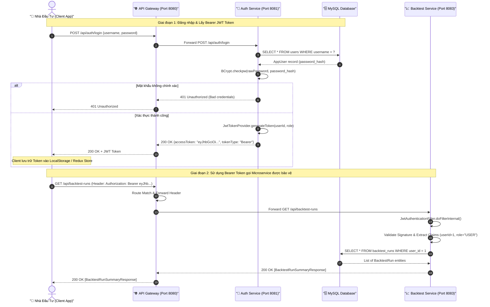

---

### 4.2 Luồng Đăng Ký Nhận Stream Nến Thời Gian Thực qua WebSocket STOMP

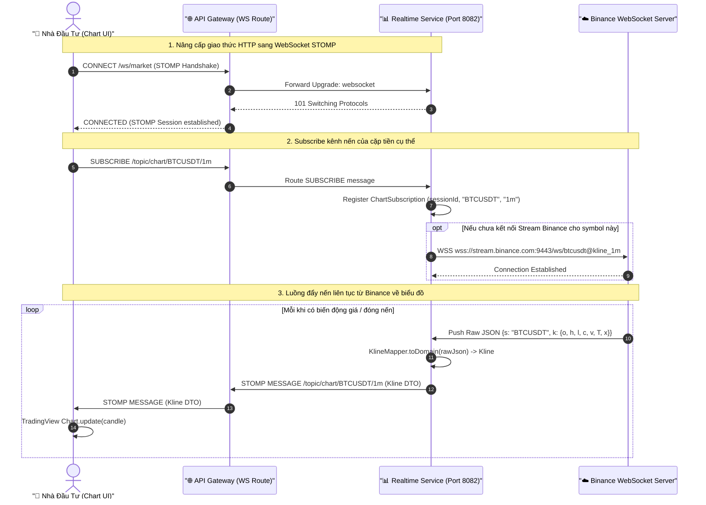

---

### 4.3 Luồng Thực Thi Kiểm Thử Chiến Lược Toàn Diện (Full Simulation Pipeline)

Đây là chuỗi xử lý quan trọng và phức tạp nhất của hệ thống, thể hiện sự kết hợp giữa phân tích kỹ thuật, mô phỏng khớp lệnh thực tế và thống kê tài chính:

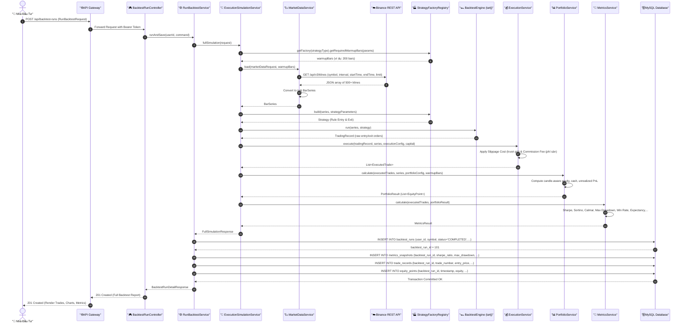

---

### 4.4 Luồng Đăng Ý Tưởng Giao Dịch & Phát Sinh Thông Báo Tương Tác

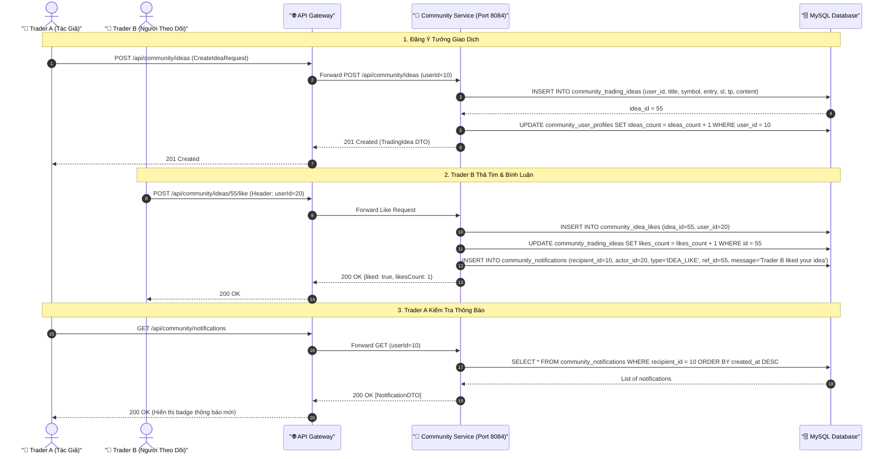

---

## 5. SƠ ĐỒ HOẠT ĐỘNG (ACTIVITY DIAGRAMS)

### 5.1 Lưu Đồ Thuật Toán Động Cơ Kiểm Thử Chiến Lược Từng Nến (Candle-by-Candle Simulation)

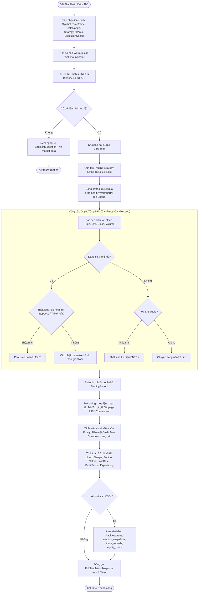

---

### 5.2 Quy Trình Gia Nhập & Phê Duyệt Thành Viên Nhóm Cộng Đồng

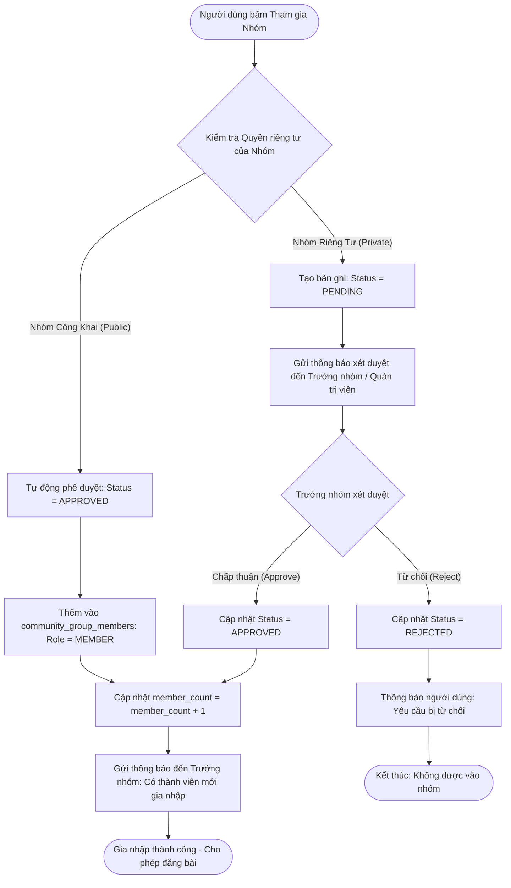

---

## 6. SƠ ĐỒ TRẠNG THÁI (STATE MACHINE DIAGRAMS)

### 6.1 Vòng Đời Phiên Chạy Backtest (`BacktestRun`)

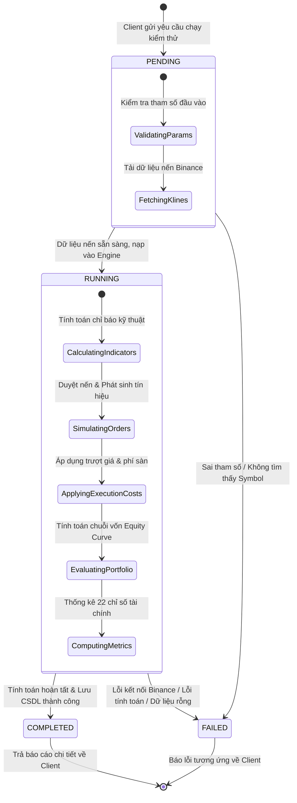

---

### 6.2 Vòng Đời Vị Thế Lệnh Giao Dịch (`TradeRecord`)

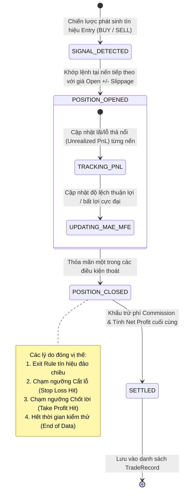

---

### 6.3 Vòng Đời Quan Hệ Bạn Bè & Trạng Thái Thành Viên Nhóm

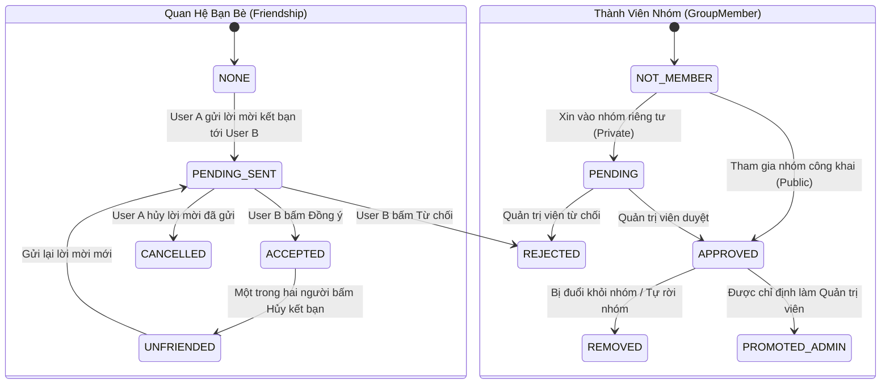

---

## 7. SƠ ĐỒ THÀNH PHẦN & TRIỂN KHAI (COMPONENT & DEPLOYMENT DIAGRAMS)

### 7.1 Sơ Đồ Thành Phần (Component Diagram)

Sơ đồ thể hiện cấu trúc mô-đun hóa, cổng giao tiếp và các luồng phụ thuộc giữa các thành phần phần mềm trong hệ thống Microservices:

```mermaid
graph TB
    subgraph "CLIENT TIER"
        UI["💻 React Single Page Application\n(TypeScript, Vite, TailwindCSS)"]
        TVChart["📊 TradingView Lightweight Chart Component"]
        WSClient["⚡ STOMP / SockJS WebSocket Client"]
        RestClient["🌐 Axios REST Client"]
        UI --- TVChart
        UI --- WSClient
        UI --- RestClient
    end

    subgraph "GATEWAY TIER"
        Gateway["🚪 Spring Cloud API Gateway (Port 8080)"]
        CorsFilter["🛡️ Global CORS & Security Filter"]
        RoutingTable["🔀 Dynamic Routing Table"]
        Gateway --- CorsFilter
        Gateway --- RoutingTable
    end

    subgraph "BACKEND MICROSERVICES TIER"
        subgraph "auth-service (Port 8081)"
            AuthCtrl["AuthController"]
            AuthSvc["AuthService"]
            JwtComp["JwtTokenProvider"]
            AuthRepo["UserRepository"]
            AuthCtrl --> AuthSvc
            AuthSvc --> JwtComp
            AuthSvc --> AuthRepo
        end

        subgraph "realtime-service (Port 8082)"
            WSCtrl["ChartWebSocketController"]
            RestMarketCtrl["MarketDataController"]
            RTMarketSvc["MarketRealtimeService"]
            BinanceClient["BinanceRestClient & WebSocketClient"]
            WSCtrl --> RTMarketSvc
            RestMarketCtrl --> RTMarketSvc
            RTMarketSvc --> BinanceClient
        end

        subgraph "backtest-service (Port 8083)"
            BacktestCtrl["BacktestRunController"]
            SimSvc["ExecutionSimulationService"]
            EngineComp["BacktestEngine (ta4j Core)"]
            StrategyReg["StrategyFactoryRegistry"]
            ExecEngine["ExecutionService (Slippage/Fees)"]
            PortEngine["PortfolioService (Equity Curve)"]
            MetricEngine["MetricsService (22 Indicators)"]
            BacktestRepo["BacktestRunRepository"]

            BacktestCtrl --> SimSvc
            SimSvc --> StrategyReg
            SimSvc --> EngineComp
            SimSvc --> ExecEngine
            SimSvc --> PortEngine
            SimSvc --> MetricEngine
            BacktestCtrl --> BacktestRepo
        end

        subgraph "community-service (Port 8084)"
            CommCtrl["TradingIdea & Post & Group Controllers"]
            CommSvc["CommunityService & NotificationService"]
            CommRepo["Community Repositories"]
            CommCtrl --> CommSvc
            CommSvc --> CommRepo
        end
    end

    subgraph "DATA STORAGE TIER"
        MySQL[("🗄️ MySQL 8.0 Database\nbacktest_trading_system")]
    end

    subgraph "EXTERNAL CLOUD TIER"
        BinanceCloud["☁️ Binance Public APIs\n(api.binance.com / wss://stream.binance.com)"]
    end

    %% Connectors
    RestClient -->|HTTP/REST| Gateway
    WSClient -->|WebSocket STOMP| Gateway

    Gateway -->|/api/auth/**| AuthCtrl
    Gateway -->|/ws/market/**| WSCtrl
    Gateway -->|/api/market/**| RestMarketCtrl
    Gateway -->|/api/backtest/**| BacktestCtrl
    Gateway -->|/api/community/**| CommCtrl

    AuthRepo -->|JDBC / JPA| MySQL
    BacktestRepo -->|JDBC / JPA| MySQL
    CommRepo -->|JDBC / JPA| MySQL

    BinanceClient -->|HTTPS REST & WSS| BinanceCloud
    SimSvc -->|Load Historical Klines| BinanceCloud
```

---

### 7.2 Sơ Đồ Triển Khai Vật Lý (Deployment Diagram)

Sơ đồ mô tả cách thức hệ thống được phân bổ trên các nút phần cứng, container và các giao thức truyền tải mạng:

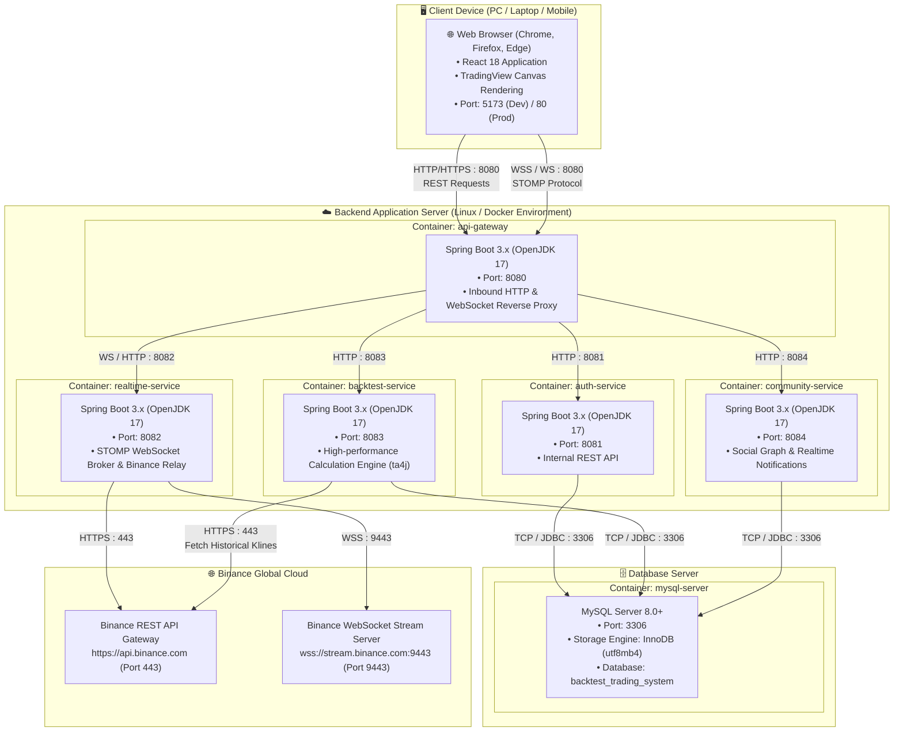

---

## 8. TỔNG KẾT & KHUYẾN NGHỊ BẢO VỆ KHÓA LUẬN (KLTN)

1. **Tính hoàn chỉnh & đồng bộ**:
   - Mọi thực thể trong Class Diagram đều đối sánh chính xác 1-1 với cấu trúc bảng trong [schema.sql](file:///d:/KLTN/trading-backtest-engine/backend/database/schema.sql) và các model Java thực tế của dự án.
   - Các Sequence Diagram phản ánh chính xác luồng gọi hàm từ Controller $\rightarrow$ Service $\rightarrow$ Engine $\rightarrow$ Mapper $\rightarrow$ Repository.
2. **Điểm nhấn chuyên sâu trong báo cáo**:
   - Nhấn mạnh vào **Phân hệ Backtest Core Engine**: Khả năng phân tách rõ ràng giữa `ta4j Strategy` (tạo tín hiệu lý thuyết) và `ExecutionSimulationService` (mô phỏng chi phí thực tế: trượt giá, phí giao dịch, số dư tài khoản).
   - Mô hình mạng xã hội kết hợp tài chính (`Community Service` liên kết trực tiếp với dữ liệu nến và cấu hình kiểm thử).
3. **Cách trích xuất sơ đồ vào Luận văn / Slide**:
   - Tất cả các sơ đồ trên đều viết bằng mã nguồn **Mermaid**. Bạn có thể sao chép trực tiếp vào các công cụ như [Mermaid Live Editor](https://mermaid.live), Notion, Obsidian hoặc xuất ra định dạng Vector SVG/PNG với độ phân giải cao để chèn vào tài liệu Word / LaTeX của Khóa luận tốt nghiệp.
