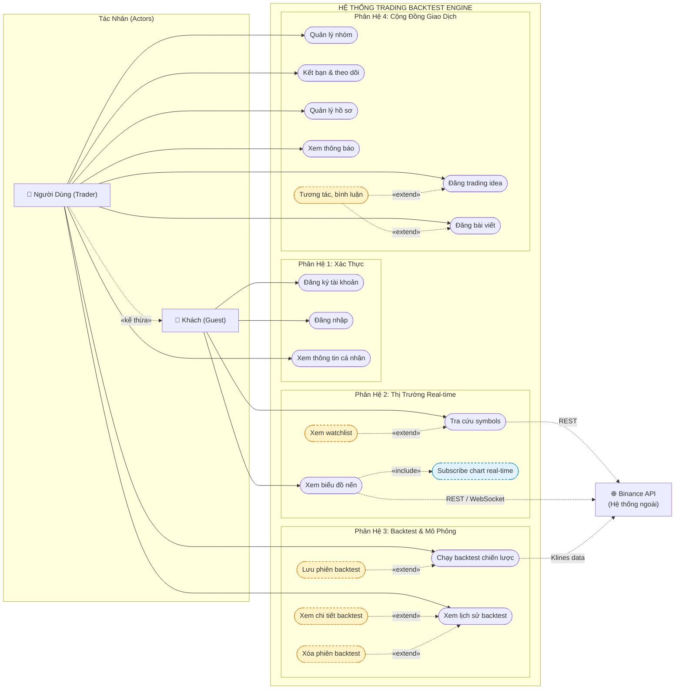
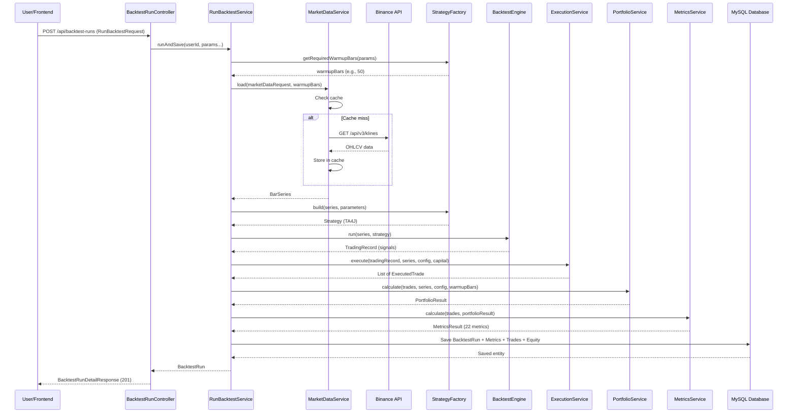
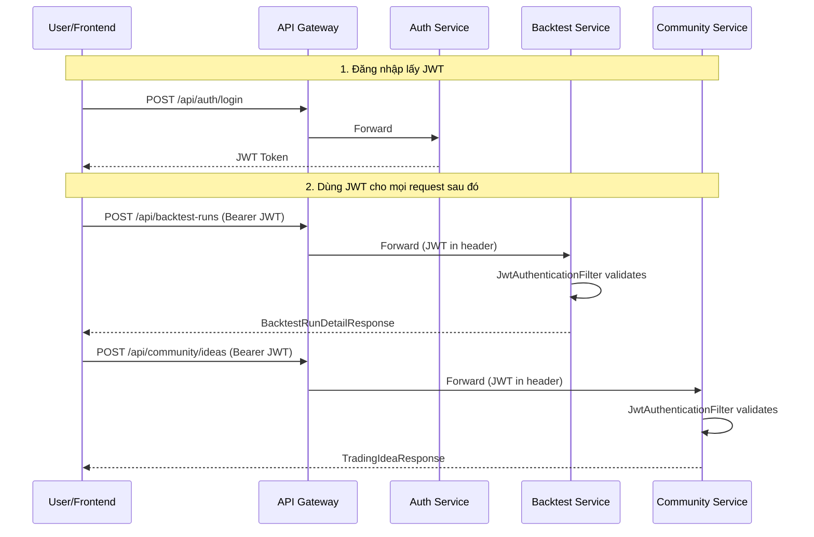
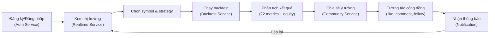

# Đặc Tả Use Case Chi Tiết — Trading Backtest Engine

> **Dự án:** Trading Backtest Engine  
> **Kiến trúc:** Microservices (4 backend services + API Gateway + React Frontend)  
> **Phiên bản phân tích:** Dựa trên mã nguồn thực tế

---

## 1. Tổng Quan Hệ Thống

### 1.1 Các Microservice

| Service | Port (mặc định) | Vai trò |
|---------|-----------------|---------|
| **API Gateway** | — | Định tuyến request tới các service |
| **Auth Service** | — | Xác thực, đăng ký, quản lý JWT |
| **Backtest Service** | — | Backtest chiến lược, mô phỏng thực thi, portfolio, metrics |
| **Realtime Service** | — | Dữ liệu thị trường real-time (REST + WebSocket) |
| **Community Service** | — | Mạng xã hội trading (ideas, posts, groups, friends) |

### 1.2 Các Tác Nhân (Actors)

| Actor | Mô tả |
|-------|-------|
| **Người dùng (User)** | Trader sử dụng hệ thống để backtest chiến lược, theo dõi thị trường, tương tác cộng đồng |
| **Khách (Guest)** | Người chưa đăng nhập, chỉ truy cập được trang login/register |
| **Hệ thống bên ngoài (Binance API)** | Cung cấp dữ liệu thị trường OHLCV, ticker, symbol |
| **WebSocket Server** | Binance WebSocket stream cung cấp dữ liệu real-time |

---

## 2. Sơ Đồ Use Case Tổng Quan

---

## 3. Đặc Tả Use Case Chi Tiết

---

### UC-01: Đăng Ký Tài Khoản

| Thuộc tính | Giá trị |
|------------|---------|
| **ID** | UC-01 |
| **Tên** | Đăng ký tài khoản mới |
| **Actor chính** | Khách (Guest) |
| **Mục tiêu** | Tạo tài khoản mới để sử dụng hệ thống |
| **Tiền điều kiện** | Chưa có tài khoản với username/email tương ứng |
| **Hậu điều kiện** | Tài khoản được tạo, JWT được cấp, user được điều hướng vào hệ thống |
| **Service xử lý** | Auth Service |
| **API Endpoint** | `POST /api/auth/register` |

**Luồng chính (Main Flow):**

| Bước | Người dùng (Frontend) | Hệ thống (Backend) |
|------|----------------------|---------------------|
| 1 | Truy cập trang web, thấy **LoginPage** | Hiển thị form đăng nhập/đăng ký |
| 2 | Chuyển sang tab **Đăng ký**, nhập `username`, `email`, `password` | — |
| 3 | Nhấn nút **Register** | — |
| 4 | — | **Frontend** gửi `POST /api/auth/register` với `RegisterRequest` |
| 5 | — | **Auth Service** validate input (Jakarta Validation) |
| 6 | — | Kiểm tra trùng `username` và `email` qua `UserRepository` |
| 7 | — | Hash password bằng BCrypt, gán role `USER`, lưu `AppUser` vào DB |
| 8 | — | Tạo JWT token qua `JwtService` từ `UserPrincipal` |
| 9 | — | Trả `AuthResponse` (token, tokenType, userInfo) — HTTP `201 Created` |
| 10 | Lưu JWT vào `localStorage`, cập nhật `AuthContext` | — |
| 11 | `AppGate` detect `user != null` → render `AppLayout` + routes | — |

**Luồng ngoại lệ:**

| Điều kiện | Xử lý |
|-----------|-------|
| Username hoặc email đã tồn tại | `UsernameAlreadyExistsException` → HTTP `409 Conflict` |
| Request body không hợp lệ (thiếu field, format sai) | `MethodArgumentNotValidException` → HTTP `400 Bad Request` |

---

### UC-02: Đăng Nhập

| Thuộc tính | Giá trị |
|------------|---------|
| **ID** | UC-02 |
| **Tên** | Đăng nhập vào hệ thống |
| **Actor chính** | Khách (Guest) |
| **Mục tiêu** | Xác thực danh tính và truy cập hệ thống |
| **Tiền điều kiện** | Đã có tài khoản hợp lệ |
| **Hậu điều kiện** | JWT được cấp, session được khởi tạo |
| **Service xử lý** | Auth Service |
| **API Endpoint** | `POST /api/auth/login` |

**Luồng chính:**

| Bước | Người dùng | Hệ thống |
|------|-----------|----------|
| 1 | Tại **LoginPage**, nhập `username` và `password` | — |
| 2 | Nhấn nút **Login** | — |
| 3 | — | Frontend gửi `POST /api/auth/login` với `LoginRequest` |
| 4 | — | `AuthService` gọi `AuthenticationManager.authenticate(...)` |
| 5 | — | `DaoAuthenticationProvider` → `CustomUserDetailsService` load user từ DB |
| 6 | — | So sánh password hash bằng BCrypt |
| 7 | — | Sinh JWT mới qua `JwtService` |
| 8 | — | Trả `AuthResponse` — HTTP `200 OK` |
| 9 | Lưu JWT, redirect vào `/products` | — |

**Luồng ngoại lệ:**

| Điều kiện | Xử lý |
|-----------|-------|
| Sai username hoặc password | `InvalidCredentialsException` → HTTP `401 Unauthorized` |

---

### UC-03: Xem Thông Tin Người Dùng Hiện Tại

| Thuộc tính | Giá trị |
|------------|---------|
| **ID** | UC-03 |
| **Tên** | Lấy thông tin user đang đăng nhập |
| **Actor chính** | Người dùng (User) |
| **Tiền điều kiện** | Đã đăng nhập, có JWT hợp lệ |
| **Service xử lý** | Auth Service |
| **API Endpoint** | `GET /api/auth/me` |

**Luồng chính:**

| Bước | Người dùng | Hệ thống |
|------|-----------|----------|
| 1 | Ứng dụng tự động gọi `/api/auth/me` khi khởi tạo | — |
| 2 | — | `JwtAuthenticationFilter` tách token từ header `Authorization: Bearer <token>` |
| 3 | — | `JwtService` extract username, validate token |
| 4 | — | Load user từ DB, set `Authentication` vào `SecurityContextHolder` |
| 5 | — | `AuthController` nhận `@AuthenticationPrincipal UserPrincipal` |
| 6 | — | Trả `UserResponse` (id, username, email, role) — HTTP `200 OK` |
| 7 | Cập nhật `AuthContext` với thông tin user | — |

---

### UC-04: Tra Cứu Trading Symbols

| Thuộc tính | Giá trị |
|------------|---------|
| **ID** | UC-04 |
| **Tên** | Tìm kiếm và xem danh sách trading symbols |
| **Actor chính** | Người dùng |
| **Service xử lý** | Realtime Service |
| **API Endpoints** | `GET /api/market/symbols`, `GET /api/market/symbols/search?q=...`, `GET /api/market/symbol/{symbol}` |

**Luồng chính:**

| Bước | Người dùng | Hệ thống |
|------|-----------|----------|
| 1 | Mở giao diện trading, nhìn vào ô tìm kiếm symbol | — |
| 2 | Gõ từ khóa (ví dụ: "BTC") | — |
| 3 | — | Frontend gửi `GET /api/market/symbols/search?q=BTC` |
| 4 | — | `MarketDataService` tìm trong cache symbols khớp query (tên symbol, base asset, quote asset) |
| 5 | — | Map kết quả sang `SymbolResponse` |
| 6 | — | Trả danh sách symbols — HTTP `200 OK` |
| 7 | Chọn một symbol (ví dụ: BTCUSDT) từ danh sách | — |
| 8 | — | Frontend gửi `GET /api/market/symbol/BTCUSDT` |
| 9 | — | Trả thông tin chi tiết symbol (`SymbolInfo`) |

---

### UC-05: Xem Watchlist Thị Trường

| Thuộc tính | Giá trị |
|------------|---------|
| **ID** | UC-05 |
| **Tên** | Xem bảng giá watchlist real-time |
| **Actor chính** | Người dùng |
| **Service xử lý** | Realtime Service |
| **API Endpoints** | `GET /api/market/watchlist`, `GET /api/market/watchlist/filter?quoteAsset=...`, `GET /api/market/watchlist/{symbol}` |

**Luồng chính:**

| Bước | Người dùng | Hệ thống |
|------|-----------|----------|
| 1 | Mở trang **Products** (trading dashboard) | — |
| 2 | — | Frontend gửi `GET /api/market/watchlist?limit=50` |
| 3 | — | `MarketDataService` trả danh sách `MarketTicker` đã cache (cập nhật real-time qua Binance WebSocket) |
| 4 | — | Sorted theo quote volume giảm dần |
| 5 | — | Map sang `MarketTickerResponse` — HTTP `200 OK` |
| 6 | Xem bảng giá: symbol, giá hiện tại, % thay đổi 24h, volume | — |
| 7 | (Tùy chọn) Lọc theo quote asset (USDT, BTC, ...) | — |
| 8 | — | Frontend gửi `GET /api/market/watchlist/filter?quoteAsset=USDT` |
| 9 | — | Trả danh sách đã lọc |

---

### UC-06: Xem Biểu Đồ Nến (Candlestick Chart)

| Thuộc tính | Giá trị |
|------------|---------|
| **ID** | UC-06 |
| **Tên** | Xem biểu đồ nến lịch sử và real-time |
| **Actor chính** | Người dùng |
| **Service xử lý** | Realtime Service |
| **API Endpoint (REST)** | `GET /api/market/klines` |
| **WebSocket** | STOMP `/app/chart/subscribe`, broadcast `/topic/chart/{symbol}/{interval}` |

**Luồng chính:**

| Bước | Người dùng | Hệ thống |
|------|-----------|----------|
| 1 | Chọn symbol (ví dụ: BTCUSDT) và timeframe (ví dụ: 1h) | — |
| 2 | — | Frontend gửi `GET /api/market/klines?symbol=BTCUSDT&interval=1h&limit=500` |
| 3 | — | `MarketDataService.fetchKlines(...)` kiểm tra cache Redis |
| 4 | — | Cache miss → gọi Binance REST API `/api/v3/klines` |
| 5 | — | Map kết quả sang `KlineResponse[]` — HTTP `200 OK` |
| 6 | Biểu đồ nến được render trên giao diện | — |
| 7 | — | Frontend mở kết nối WebSocket STOMP |
| 8 | — | Gửi message tới `/app/chart/subscribe` với `{symbol: "BTCUSDT", interval: "1h"}` |
| 9 | — | `ChartWebSocketController` tạo subscription, bắt đầu stream từ Binance WebSocket |
| 10 | — | Mỗi nến mới → broadcast tới `/topic/chart/BTCUSDT/1h` |
| 11 | Biểu đồ cập nhật real-time nến đang hình thành | — |
| 12 | Chuyển sang symbol/timeframe khác | — |
| 13 | — | Gửi unsubscribe cho subscription cũ: `/app/chart/unsubscribe/{symbol}/{interval}` |
| 14 | — | Subscribe lại symbol/timeframe mới |

**Luồng ngoại lệ:**

| Điều kiện | Xử lý |
|-----------|-------|
| Interval không hợp lệ | `Interval.validate()` throw exception → HTTP `400` |
| Symbol không tìm thấy | `SymbolNotFoundException` → HTTP `404` |
| Mất kết nối WebSocket | `SessionDisconnectEvent` → tự động cleanup tất cả subscriptions của session |

---

### UC-07: Chạy Backtest Chiến Lược Giao Dịch

| Thuộc tính | Giá trị |
|------------|---------|
| **ID** | UC-07 |
| **Tên** | Chạy backtest và lưu kết quả |
| **Actor chính** | Người dùng |
| **Mục tiêu** | Kiểm tra hiệu suất chiến lược trading trên dữ liệu lịch sử |
| **Tiền điều kiện** | Đã đăng nhập |
| **Hậu điều kiện** | Kết quả backtest được lưu vào DB, trả về cho user |
| **Service xử lý** | Backtest Service |
| **API Endpoint** | `POST /api/backtest-runs` |

**Luồng chính (End-to-End Pipeline):**

| Bước | Người dùng | Hệ thống |
|------|-----------|----------|
| 1 | Tại **Products Page**, chọn symbol (BTCUSDT), timeframe (1h) | — |
| 2 | Chọn chiến lược: **SMA_CROSS**, **RSI**, hoặc **MACD** | — |
| 3 | Nhập tham số chiến lược (ví dụ: SMA shortPeriod=10, longPeriod=50) | — |
| 4 | Nhập cấu hình mô phỏng: vốn ban đầu, commission rate, slippage rate, position size % | — |
| 5 | Chọn khoảng thời gian: startTime, endTime | — |
| 6 | Nhấn nút **Run Backtest** | — |
| 7 | — | Frontend gửi `POST /api/backtest-runs` với `RunBacktestRequest` |
| 8 | — | **Bước 1 — Market Data**: `MarketDataService.load(request, warmupBars)` |
|   | — | → Kiểm tra in-memory cache (`SYMBOL-TIMEFRAME` key) |
|   | — | → Cache miss: gọi Binance REST API `/api/v3/klines` |
|   | — | → Nạp thêm warmup bars (phụ thuộc strategy: SMA=longPeriod, MACD=longPeriod+signalPeriod-1, RSI=period) |
|   | — | → Trả về `BarSeries` (TA4J) |
| 9 | — | **Bước 2 — Strategy**: `StrategyFactoryRegistry.getFactory(type)` |
|   | — | → `TradingStrategyFactory.build(series, parameters)` → tạo `Strategy` (TA4J) |
| 10 | — | **Bước 3 — Backtest**: `BacktestEngine.run(series, strategy)` |
|   | — | → `BarSeriesManager` chạy strategy trên toàn bộ series |
|   | — | → Trả về `TradingRecord` (entry/exit signals, chưa có phí) |
| 11 | — | **Bước 4 — Execution Simulation**: `ExecutionService.execute(tradingRecord, series, config, capital)` |
|   | — | → Cho mỗi signal: `QuantityCalculator` (sizing) → `SlippageCalculator` (trượt giá) → `CommissionCalculator` (phí) |
|   | — | → Trả về `List<ExecutedTrade>` (đã tính netProfit = gross - commission - slippage) |
| 12 | — | **Bước 5 — Portfolio**: `PortfolioService.calculate(executedTrades, series, config, warmupBars)` |
|   | — | → Mark-to-market equity curve: tính equity tại mỗi bar |
|   | — | → Trả về `PortfolioResult` (equityCurve, totalReturn, maxDrawdown) |
| 13 | — | **Bước 6 — Metrics**: `MetricsService.calculate(executedTrades, portfolioResult)` |
|   | — | → Tính **22 chỉ số hiệu suất**: WinRate, ProfitFactor, Sharpe, Sortino, CAGR, MaxDrawdown, Calmar, Recovery Factor, Expectancy, Reward/Risk, Best/Worst Trade, Consecutive Wins/Losses, v.v. |
| 14 | — | **Bước 7 — Persistence**: Lưu `BacktestRun` + `MetricsSnapshot` + `TradeRecords` + `EquityPoints` vào MySQL |
| 15 | — | Trả `BacktestRunDetailResponse` — HTTP `201 Created` |
| 16 | Xem kết quả: biểu đồ equity, bảng trades, bảng metrics | — |

> [!IMPORTANT]
> **Pipeline xử lý tuần tự**: Market Data → Strategy → Backtest → Execution → Portfolio → Metrics → Persistence. Mỗi bước phụ thuộc output của bước trước.

**Chuỗi tương tác chi tiết (Sequence):**

---

### UC-08: Xem Lịch Sử Backtest

| Thuộc tính | Giá trị |
|------------|---------|
| **ID** | UC-08 |
| **Tên** | Xem danh sách các phiên backtest đã chạy |
| **Actor chính** | Người dùng |
| **Service xử lý** | Backtest Service |
| **API Endpoint** | `GET /api/backtest-runs?page=0&size=10` |

**Luồng chính:**

| Bước | Người dùng | Hệ thống |
|------|-----------|----------|
| 1 | Mở tab lịch sử backtest trên **Products Page** | — |
| 2 | — | Frontend gửi `GET /api/backtest-runs?page=0&size=10` |
| 3 | — | `BacktestPersistenceService.findBacktestRuns(userId, page, size)` |
| 4 | — | Truy vấn DB theo `user_id`, sort theo `created_at DESC` |
| 5 | — | Map sang `BacktestRunSummaryResponse[]` — HTTP `200 OK` |
| 6 | Xem danh sách: strategy, symbol, timeframe, return %, win rate, thời gian | — |
| 7 | (Phân trang) Chuyển trang | Gửi request với `page` khác |

---

### UC-09: Xem Chi Tiết Một Phiên Backtest

| Thuộc tính | Giá trị |
|------------|---------|
| **ID** | UC-09 |
| **Tên** | Xem chi tiết kết quả backtest (trades, metrics, equity) |
| **Actor chính** | Người dùng |
| **Service xử lý** | Backtest Service |
| **API Endpoints** | `GET /api/backtest-runs/{id}`, `GET /api/backtest-runs/{id}/trades`, `GET /api/backtest-runs/{id}/metrics`, `GET /api/backtest-runs/{id}/equity` |

**Luồng chính:**

| Bước | Người dùng | Hệ thống |
|------|-----------|----------|
| 1 | Click vào một phiên backtest trong danh sách | — |
| 2 | — | Frontend gửi `GET /api/backtest-runs/{id}` |
| 3 | — | `BacktestPersistenceService.findBacktestRun(userId, id)` |
| 4 | — | Trả `BacktestRunDetailResponse` bao gồm: metrics, trades[], equityCurve[] |
| 5 | Xem **Bảng metrics**: 22 chỉ số hiệu suất | — |
| 6 | Xem **Bảng trades**: từng lệnh entry/exit, giá, PnL, MFE/MAE | — |
| 7 | Xem **Biểu đồ equity curve**: đường cong vốn theo thời gian | — |
| 8 | (Tùy chọn) Gọi riêng từng endpoint cho lazy loading | — |

---

### UC-10: Xóa Phiên Backtest

| Thuộc tính | Giá trị |
|------------|---------|
| **ID** | UC-10 |
| **Tên** | Xóa một phiên backtest |
| **Actor chính** | Người dùng |
| **Service xử lý** | Backtest Service |
| **API Endpoint** | `DELETE /api/backtest-runs/{id}` |

**Luồng chính:**

| Bước | Người dùng | Hệ thống |
|------|-----------|----------|
| 1 | Tại danh sách backtest, nhấn nút **Xóa** | — |
| 2 | Xác nhận xóa | — |
| 3 | — | Frontend gửi `DELETE /api/backtest-runs/{id}` |
| 4 | — | `BacktestPersistenceService.deleteByIdAndUser(id, userId)` |
| 5 | — | Cascade delete: `backtest_runs` → `metrics_snapshots` + `trade_records` + `equity_points` |
| 6 | — | HTTP `204 No Content` |
| 7 | Danh sách được refresh, phiên backtest biến mất | — |

---

### UC-11: Đăng Trading Idea

| Thuộc tính | Giá trị |
|------------|---------|
| **ID** | UC-11 |
| **Tên** | Đăng ý tưởng giao dịch lên cộng đồng |
| **Actor chính** | Người dùng |
| **Service xử lý** | Community Service |
| **API Endpoint** | `POST /api/community/ideas` |

**Luồng chính:**

| Bước | Người dùng | Hệ thống |
|------|-----------|----------|
| 1 | Mở trang **Community**, nhấn **Publish Idea** | — |
| 2 | Điền thông tin: title, symbol, asset class, timeframe, direction (LONG/SHORT) | — |
| 3 | Nhập entry price, target price, stop loss price | — |
| 4 | Viết nội dung phân tích (summary + content), upload cover image | — |
| 5 | Thêm tags phân loại | — |
| 6 | Nhấn **Publish** | — |
| 7 | — | Frontend gửi `POST /api/community/ideas` với `CreateIdeaRequest` |
| 8 | — | `IdeaService.createIdea(request, user)` |
| 9 | — | Tạo `CommunityTradingIdea` với thông tin author từ `UserPrincipal` |
| 10 | — | Tăng `ideas_count` trong `community_user_profiles` |
| 11 | — | Lưu vào DB, trả `TradingIdeaResponse` — HTTP `201 Created` |
| 12 | Idea xuất hiện trên feed cộng đồng | — |

---

### UC-12: Duyệt & Tương Tác Trading Ideas

| Thuộc tính | Giá trị |
|------------|---------|
| **ID** | UC-12 |
| **Tên** | Xem, like, boost, bookmark, bình luận trading idea |
| **Actor chính** | Người dùng |
| **Service xử lý** | Community Service |
| **API Endpoints** | `GET /api/community/ideas`, `GET /api/community/ideas/{id}`, `POST /{id}/like`, `POST /{id}/boost`, `POST /{id}/bookmark`, `POST /{id}/comments` |

**Luồng chính (duyệt danh sách):**

| Bước | Người dùng | Hệ thống |
|------|-----------|----------|
| 1 | Mở trang **Community** | — |
| 2 | — | Frontend gửi `GET /api/community/ideas?category=popular&page=0&size=12` |
| 3 | — | `IdeaService.getIdeas(category, query, sort, page, size)` |
| 4 | — | Trả `Page<TradingIdeaResponse>` — HTTP `200 OK` |
| 5 | Xem grid/list các ideas: thumbnail, title, symbol, direction, author | — |
| 6 | (Lọc) Chọn category, search query, sort order | Gửi request với filter mới |

**Luồng chính (xem chi tiết & tương tác):**

| Bước | Người dùng | Hệ thống |
|------|-----------|----------|
| 1 | Click vào một trading idea | — |
| 2 | — | Navigate tới `/community/ideas/{id}` |
| 3 | — | Frontend gửi `GET /api/community/ideas/{id}` |
| 4 | — | Trả chi tiết idea — HTTP `200 OK` |
| 5 | — | Song song gửi `GET /api/community/ideas/{id}/comments` |
| 6 | — | Song song gửi `GET /api/community/ideas/{id}/related` |
| 7 | — | Song song gửi `GET /api/community/ideas/{id}/author-ideas?authorId=...` |
| 8 | Xem nội dung phân tích, biểu đồ, entry/target/SL | — |
| 9 | Nhấn **Like** (toggle) | `POST /api/community/ideas/{id}/like` → toggle like, cập nhật `likes_count` |
| 10 | Nhấn **Boost** | `POST /api/community/ideas/{id}/boost` → toggle boost, cập nhật `boosts_count` |
| 11 | Nhấn **Bookmark** (toggle) | `POST /api/community/ideas/{id}/bookmark` → toggle bookmark |
| 12 | Viết bình luận, nhấn **Post Comment** | `POST /api/community/ideas/{id}/comments` → tạo comment, tăng `comments_count` |

---

### UC-13: Đăng Bài Viết (Post)

| Thuộc tính | Giá trị |
|------------|---------|
| **ID** | UC-13 |
| **Tên** | Đăng bài viết lên feed cộng đồng |
| **Actor chính** | Người dùng |
| **Service xử lý** | Community Service |
| **API Endpoint** | `POST /api/community/posts` |

**Luồng chính:**

| Bước | Người dùng | Hệ thống |
|------|-----------|----------|
| 1 | Tại feed cộng đồng, nhập nội dung bài viết | — |
| 2 | (Tùy chọn) Đính kèm media, chọn privacy (public/friends) | — |
| 3 | (Tùy chọn) Đăng trong group cụ thể | — |
| 4 | Nhấn **Post** | — |
| 5 | — | Frontend gửi `POST /api/community/posts` với `CreatePostRequest` |
| 6 | — | `PostService.createPost(request, user)` |
| 7 | — | Tạo `CommunityPost`, lưu vào DB |
| 8 | — | Trả `PostResponse` — HTTP `201 Created` |
| 9 | Bài viết xuất hiện trên feed | — |

---

### UC-14: Tương Tác Bài Viết (React, Comment)

| Thuộc tính | Giá trị |
|------------|---------|
| **ID** | UC-14 |
| **Tên** | Reaction, bình luận, reply bài viết |
| **Actor chính** | Người dùng |
| **Service xử lý** | Community Service |
| **API Endpoints** | `POST /api/community/posts/{id}/react`, `POST /{id}/comments`, `POST /comments/{commentId}/like` |

**Luồng chính:**

| Bước | Người dùng | Hệ thống |
|------|-----------|----------|
| 1 | Xem feed: `GET /api/community/posts?page=0&size=10` | — |
| 2 | — | `PostService.getFeed(page, size)` trả `Page<PostResponse>` |
| 3 | Nhấn reaction (Like/Love/Haha/Wow/Sad/Angry) | — |
| 4 | — | `POST /api/community/posts/{id}/react` với `ReactionRequest{type}` |
| 5 | — | `PostService.reactToPost(id, type, user)` → toggle reaction, cập nhật counters |
| 6 | Viết bình luận (hỗ trợ reply qua `parentId`) | — |
| 7 | — | `POST /api/community/posts/{id}/comments` với `PostCommentRequest` |
| 8 | — | Tạo comment (có thể nested), tăng `comment_count` + `reply_count` |
| 9 | Like một comment | — |
| 10 | — | `POST /api/community/posts/comments/{commentId}/like` → toggle like |

> [!NOTE]
> **Hệ thống reactions đa dạng**: Posts hỗ trợ 6 loại reaction (like, love, haha, wow, sad, angry) khác với Ideas chỉ có like/boost. Mỗi user chỉ có 1 reaction per post (toggle/switch).

---

### UC-15: Gửi Lời Mời Kết Bạn

| Thuộc tính | Giá trị |
|------------|---------|
| **ID** | UC-15 |
| **Tên** | Gửi và phản hồi lời mời kết bạn |
| **Actor chính** | Người dùng |
| **Service xử lý** | Community Service |
| **API Endpoints** | `POST /api/community/friends/request/{targetUserId}`, `POST /friends/{friendshipId}/respond`, `DELETE /friends/{targetUserId}`, `GET /friends`, `GET /friends/pending` |

**Luồng chính (gửi lời mời):**

| Bước | Người dùng | Hệ thống |
|------|-----------|----------|
| 1 | Xem profile của user khác | — |
| 2 | Nhấn **Add Friend** | — |
| 3 | — | `POST /api/community/friends/request/{targetUserId}` |
| 4 | — | `SocialService.sendFriendRequest(targetUserId, user)` |
| 5 | — | Tạo `CommunityFriendship` với status `PENDING` |
| 6 | — | Trả `FriendshipResponse` |
| 7 | Nút chuyển sang "Pending" | — |

**Luồng chính (phản hồi lời mời):**

| Bước | Người dùng | Hệ thống |
|------|-----------|----------|
| 1 | Mở danh sách lời mời chờ: `GET /api/community/friends/pending` | — |
| 2 | Nhấn **Accept** hoặc **Reject** | — |
| 3 | — | `POST /api/community/friends/{friendshipId}/respond?accept=true/false` |
| 4 | — | Cập nhật status thành `ACCEPTED` hoặc `REJECTED` |
| 5 | Nếu accepted → cả hai xuất hiện trong danh sách bạn bè | — |

**Luồng phụ (xóa bạn):**

| Bước | Người dùng | Hệ thống |
|------|-----------|----------|
| 1 | Nhấn **Remove Friend** | `DELETE /api/community/friends/{targetUserId}` |
| 2 | — | `SocialService.removeFriend(targetUserId, user)` |

---

### UC-16: Theo Dõi / Bỏ Theo Dõi Người Dùng

| Thuộc tính | Giá trị |
|------------|---------|
| **ID** | UC-16 |
| **Tên** | Follow/Unfollow user khác |
| **Actor chính** | Người dùng |
| **Service xử lý** | Community Service |
| **API Endpoints** | `POST /api/community/follow/{targetUserId}`, `DELETE /api/community/follow/{targetUserId}` |

**Luồng chính:**

| Bước | Người dùng | Hệ thống |
|------|-----------|----------|
| 1 | Xem profile user khác, nhấn **Follow** | — |
| 2 | — | `POST /api/community/follow/{targetUserId}` |
| 3 | — | `SocialService.followUser(targetUserId, user)` |
| 4 | — | Tạo `CommunityFollow`, cập nhật `followers_count`/`following_count` trong profiles |
| 5 | — | Trả `true` (đã follow) |
| 6 | Nhấn **Unfollow** | `DELETE /api/community/follow/{targetUserId}` |
| 7 | — | Xóa record follow, giảm counters |

---

### UC-17: Quản Lý Nhóm (Group)

| Thuộc tính | Giá trị |
|------------|---------|
| **ID** | UC-17 |
| **Tên** | Tạo, tham gia, rời nhóm cộng đồng |
| **Actor chính** | Người dùng |
| **Service xử lý** | Community Service |
| **API Endpoints** | `POST /api/community/groups`, `POST /{id}/join`, `POST /{id}/leave`, `GET /groups`, `GET /groups/{id}`, `GET /groups/my` |

**Luồng chính (tạo nhóm):**

| Bước | Người dùng | Hệ thống |
|------|-----------|----------|
| 1 | Nhấn **Create Group** | — |
| 2 | Nhập name, description, cover URL, privacy (public/private) | — |
| 3 | Nhấn **Create** | — |
| 4 | — | `POST /api/community/groups` với `CreateGroupRequest` |
| 5 | — | `GroupService.createGroup(request, user)` |
| 6 | — | Tạo `CommunityGroup`, tự động thêm creator làm member (role: ADMIN) |
| 7 | — | Trả `GroupResponse` — HTTP `201 Created` |

**Luồng chính (tham gia/rời nhóm):**

| Bước | Người dùng | Hệ thống |
|------|-----------|----------|
| 1 | Duyệt danh sách nhóm: `GET /api/community/groups` | — |
| 2 | Nhấn **Join** vào một nhóm | `POST /api/community/groups/{id}/join` |
| 3 | — | Tạo `CommunityGroupMember`, tăng `member_count` |
| 4 | Nhấn **Leave** | `POST /api/community/groups/{id}/leave` |
| 5 | — | Xóa membership, giảm `member_count` |

---

### UC-18: Quản Lý Hồ Sơ Người Dùng

| Thuộc tính | Giá trị |
|------------|---------|
| **ID** | UC-18 |
| **Tên** | Xem và cập nhật hồ sơ cá nhân cộng đồng |
| **Actor chính** | Người dùng |
| **Service xử lý** | Community Service |
| **API Endpoints** | `GET /api/community/profile/me`, `PUT /api/community/profile`, `GET /profile/{userId}`, `GET /profile/by-username/{username}` |

**Luồng chính:**

| Bước | Người dùng | Hệ thống |
|------|-----------|----------|
| 1 | Mở trang hồ sơ cá nhân | — |
| 2 | — | `GET /api/community/profile/me` |
| 3 | — | `UserProfileService.getOrCreateProfile(userId, username, displayName, null)` — auto-create nếu chưa có |
| 4 | — | Trả `UserProfileResponse` (displayName, avatar, bio, badge, reputation, followers/following counts) |
| 5 | Chỉnh sửa: displayName, avatar URL, bio | — |
| 6 | Nhấn **Save** | `PUT /api/community/profile` với `UpdateUserProfileRequest` |
| 7 | — | `UserProfileService.updateProfile(userId, request)` |

**Luồng phụ (xem profile người khác):**

| Bước | Người dùng | Hệ thống |
|------|-----------|----------|
| 1 | Click vào avatar/tên user khác | — |
| 2 | — | `GET /api/community/profile/{userId}` hoặc `GET /api/community/profile/by-username/{username}` |
| 3 | Xem thông tin, reputation, số lượng ideas, followers | — |

---

### UC-19: Quản Lý Thông Báo

| Thuộc tính | Giá trị |
|------------|---------|
| **ID** | UC-19 |
| **Tên** | Xem và quản lý thông báo |
| **Actor chính** | Người dùng |
| **Service xử lý** | Community Service |
| **API Endpoints** | `GET /api/community/notifications`, `GET /notifications/unread-count`, `POST /notifications/{id}/read`, `POST /notifications/read-all` |

**Luồng chính:**

| Bước | Người dùng | Hệ thống |
|------|-----------|----------|
| 1 | Nhìn icon notification trên navbar | — |
| 2 | — | Frontend gọi `GET /api/community/notifications/unread-count` |
| 3 | — | `NotificationService.getUnreadCount(userId)` → trả số lượng chưa đọc |
| 4 | Click icon → mở dropdown/panel thông báo | — |
| 5 | — | `GET /api/community/notifications?page=0&size=20` |
| 6 | — | Trả `Page<NotificationResponse>` (actor, type, message, reference, isRead, createdAt) |
| 7 | Xem thông báo: "UserA liked your idea", "UserB sent you a friend request", v.v. | — |
| 8 | Click vào thông báo cụ thể | `POST /api/community/notifications/{id}/read` → đánh dấu đã đọc |
| 9 | Nhấn **Mark All as Read** | `POST /api/community/notifications/read-all` |

> [!TIP]
> Thông báo được tạo tự động bởi hệ thống khi có các sự kiện: like idea, comment, friend request, follow, v.v. Chúng được lưu trong bảng `community_notifications` với các trường `type` và `reference_id` để liên kết tới entity gốc.

---

### UC-20: Chạy Mô Phỏng Đầy Đủ (Full Simulation)

| Thuộc tính | Giá trị |
|------------|---------|
| **ID** | UC-20 |
| **Tên** | Chạy mô phỏng đầy đủ (trades + equity + metrics) không lưu DB |
| **Actor chính** | Người dùng |
| **Service xử lý** | Backtest Service |
| **API Endpoint** | `POST /api/execution/simulation/full` |

**Luồng chính:**

| Bước | Người dùng | Hệ thống |
|------|-----------|----------|
| 1 | Nhập tham số mô phỏng (tương tự UC-07) | — |
| 2 | Nhấn **Quick Simulate** (không lưu) | — |
| 3 | — | Frontend gửi `POST /api/execution/simulation/full` với `PortfolioSimulationRequest` |
| 4 | — | `ExecutionSimulationService.fullSimulation(request)` |
| 5 | — | Chạy pipeline đầy đủ: Market → Strategy → Backtest → Execution → Portfolio → Metrics |
| 6 | — | **Không lưu** vào DB (chỉ trả kết quả) |
| 7 | — | Trả `FullSimulationResponse` (trades + equityCurve + 22 metrics) — HTTP `200 OK` |
| 8 | Xem kết quả preview ngay lập tức | — |

---

## 4. Ma Trận Use Case – Actor

| Use Case | Khách | Người dùng | Binance API |
|----------|-------|-----------|-------------|
| UC-01: Đăng ký | ✅ | — | — |
| UC-02: Đăng nhập | ✅ | — | — |
| UC-03: Xem thông tin user | — | ✅ | — |
| UC-04: Tra cứu symbols | — | ✅ | ✅ (nguồn dữ liệu) |
| UC-05: Xem watchlist | — | ✅ | ✅ (real-time ticker) |
| UC-06: Xem biểu đồ nến | — | ✅ | ✅ (klines + WebSocket) |
| UC-07: Chạy backtest | — | ✅ | ✅ (market data) |
| UC-08: Xem lịch sử backtest | — | ✅ | — |
| UC-09: Xem chi tiết backtest | — | ✅ | — |
| UC-10: Xóa phiên backtest | — | ✅ | — |
| UC-11: Đăng trading idea | — | ✅ | — |
| UC-12: Tương tác idea | — | ✅ | — |
| UC-13: Đăng bài viết | — | ✅ | — |
| UC-14: Tương tác bài viết | — | ✅ | — |
| UC-15: Kết bạn | — | ✅ | — |
| UC-16: Follow/Unfollow | — | ✅ | — |
| UC-17: Quản lý nhóm | — | ✅ | — |
| UC-18: Quản lý hồ sơ | — | ✅ | — |
| UC-19: Quản lý thông báo | — | ✅ | — |
| UC-20: Full simulation | — | ✅ | ✅ (market data) |

---

## 5. Ma Trận Use Case – Service

| Use Case | Auth Service | Backtest Service | Realtime Service | Community Service |
|----------|-------------|-----------------|-----------------|------------------|
| UC-01 | ✅ | — | — | — |
| UC-02 | ✅ | — | — | — |
| UC-03 | ✅ | — | — | — |
| UC-04 | — | — | ✅ | — |
| UC-05 | — | — | ✅ | — |
| UC-06 | — | — | ✅ | — |
| UC-07 | — | ✅ | — | — |
| UC-08 | — | ✅ | — | — |
| UC-09 | — | ✅ | — | — |
| UC-10 | — | ✅ | — | — |
| UC-11 | — | — | — | ✅ |
| UC-12 | — | — | — | ✅ |
| UC-13 | — | — | — | ✅ |
| UC-14 | — | — | — | ✅ |
| UC-15 | — | — | — | ✅ |
| UC-16 | — | — | — | ✅ |
| UC-17 | — | — | — | ✅ |
| UC-18 | — | — | — | ✅ |
| UC-19 | — | — | — | ✅ |
| UC-20 | — | ✅ | — | — |

---

## 6. Chuỗi Tương Tác Cross-Service

### 6.1 Luồng xác thực xuyên suốt (JWT Cross-Service)

### 6.2 Luồng người dùng hoàn chỉnh (Full User Journey)

---

## 7. Chiến Lược Giao Dịch Được Hỗ Trợ

| Strategy | Tham số | Warmup Bars | Entry Rule | Exit Rule |
|----------|---------|-------------|------------|-----------|
| **SMA_CROSS** | shortPeriod, longPeriod | longPeriod | SMA ngắn cắt lên SMA dài | SMA ngắn cắt xuống SMA dài |
| **MACD** | shortPeriod, longPeriod, signalPeriod | longPeriod + signalPeriod - 1 | MACD cắt lên signal line | MACD cắt xuống signal line |
| **RSI** | period, overbought, oversold | period | RSI < oversold | RSI > overbought |

---

## 8. Danh Sách 22 Metrics Hiệu Suất

| # | Metric | Loại | Mô tả |
|---|--------|------|-------|
| 1 | Total Return % | Return-based | Tổng lợi nhuận phần trăm |
| 2 | CAGR | Return-based | Tốc độ tăng trưởng kép hàng năm |
| 3 | Total Trades | Trade-based | Tổng số lệnh |
| 4 | Winning Trades | Trade-based | Số lệnh thắng |
| 5 | Losing Trades | Trade-based | Số lệnh thua |
| 6 | Win Rate | Trade-based | Tỷ lệ thắng |
| 7 | Profit Factor | Trade-based | Tổng lãi / Tổng lỗ |
| 8 | Average Win | Trade-based | Lãi trung bình mỗi lệnh thắng |
| 9 | Average Loss | Trade-based | Lỗ trung bình mỗi lệnh thua |
| 10 | Best Trade | Trade-based | Lệnh có PnL cao nhất |
| 11 | Worst Trade | Trade-based | Lệnh có PnL thấp nhất |
| 12 | Max Consecutive Wins | Trade-based | Chuỗi thắng dài nhất |
| 13 | Max Consecutive Losses | Trade-based | Chuỗi thua dài nhất |
| 14 | Expectancy | Trade-based | Kỳ vọng lãi mỗi lệnh |
| 15 | Reward/Risk Ratio | Trade-based | Tỷ lệ lãi/rủi ro |
| 16 | Max Drawdown | Risk | Sụt giảm tối đa từ đỉnh |
| 17 | Recovery Factor | Risk | Tổng lãi / Max Drawdown |
| 18 | Sharpe Ratio | Risk | Lợi nhuận điều chỉnh rủi ro (dùng equity curve) |
| 19 | Sortino Ratio | Risk | Lợi nhuận điều chỉnh rủi ro giảm (downside deviation) |
| 20 | Calmar Ratio | Risk | CAGR / Max Drawdown |
| 21 | Initial Capital | Info | Vốn ban đầu |
| 22 | Final Balance | Info | Số dư cuối kỳ |
